# Clients and entry points

Every request enters through a file under `api/`. The same handlers serve
on Vercel (filesystem routing + `vercel.json` rewrites) and on the Rack
(`rack-server.mjs` reproduces that routing) — see
[07-hosting-and-release.md](07-hosting-and-release.md).

## Who connects

- **Native MCP clients** (Claude / Muse, other compatible clients) —
  `POST /api/mcp` (optionally `/api/mcp/:connector`), Streamable HTTP,
  bearer token issued by this server's own OAuth. Discovery documents are
  served from `api/well-known/oauth-authorization-server.js` and
  `oauth-protected-resource.js`; `trustedMcpOrigin()` in `api/mcp.js`
  builds them only from `PUBLIC_BASE_URL`, never from request Host headers.
- **The Hub (optional)** — connects over the RTC HTTPS door, not native
  MCP. See [06-rtc-and-hub.md](06-rtc-and-hub.md).
- **People in a browser** — sign-in, Google linking, consent, owner and
  developer pages (below). Browser MCP clients use bearer auth; the MCP
  handler never reads cookies.
- **Developers / test harnesses** — `api/developer/*` test-pass routes and
  the RTC pass door, gated by their own issuance flows in `src/developer/`.

## Door map

```mermaid
flowchart TD
  MCP["api/mcp.js — MCP endpoint<br/>fresh Server + transport per request"]
  RTCG["api/rtc-gateway.js — RTC door<br/>contract · openapi · whoami · tools · results"]
  OA["api/oauth/authorize.js — consent + login"]
  ORG["api/oauth/register.js — dynamic client registration (CIMD)"]
  OT["api/oauth/token.js — code → access/refresh tokens"]
  ORV["api/oauth/revoke.js"]
  GA["api/google/authorize.js + callback.js<br/>link a Google mailbox (owner path)"]
  AG["api/auth/google/start.js + callback.js<br/>public Google sign-in (P10)"]
  AS["api/auth/session.js · api/auth/logout.js"]
  ACC["api/account.js — account / connection pages"]
  OWN["api/owner/clients.js · migration.js ·<br/>pilot-readiness.js · token-readiness.js"]
  DEV["api/developer/connect.js · test-pass.js ·<br/>test-pass-issue.js"]
  RP["api/rtc/passes.js — RTC pass issuance"]
  WK["api/well-known/* — OAuth discovery + muse-client.json"]
  PUB["api/index.js — front door / product home<br/>api/brand.js · privacy.js · support.js · data-deletion.js"]

  MCP --> REG["src/tools/index.js registry"]
  RTCG --> REG
  OA --> DB[("Postgres — src/db.js, src/principals/*")]
  ORG --> DB
  OT --> DB
  GA --> DB
  AG --> DB
  OWN --> DB
  DEV --> DB
  RP --> DB
```

## Notes

- `api/mcp.js` does three cached one-time steps per warm instance
  (`src/once.js`): `initSchema()`, the legacy single-account migration
  (`ensureMigrated()`), and then per-request token lookup. A failed step
  clears its cache so the next request retries.
- One connection can act on **any Google account its person linked**: a
  tool call may name an `account` argument; `clientsFor()` in `api/mcp.js`
  resolves it against that principal's own linked accounts only
  (`matchLinkedAccount`), never a global roster.
- `api/rtc-gateway.js` shares the exact registry handlers with
  `api/mcp.js`; externally the tools are exposed with the `workspace_`
  prefix and translated back by `toInternal()`.
