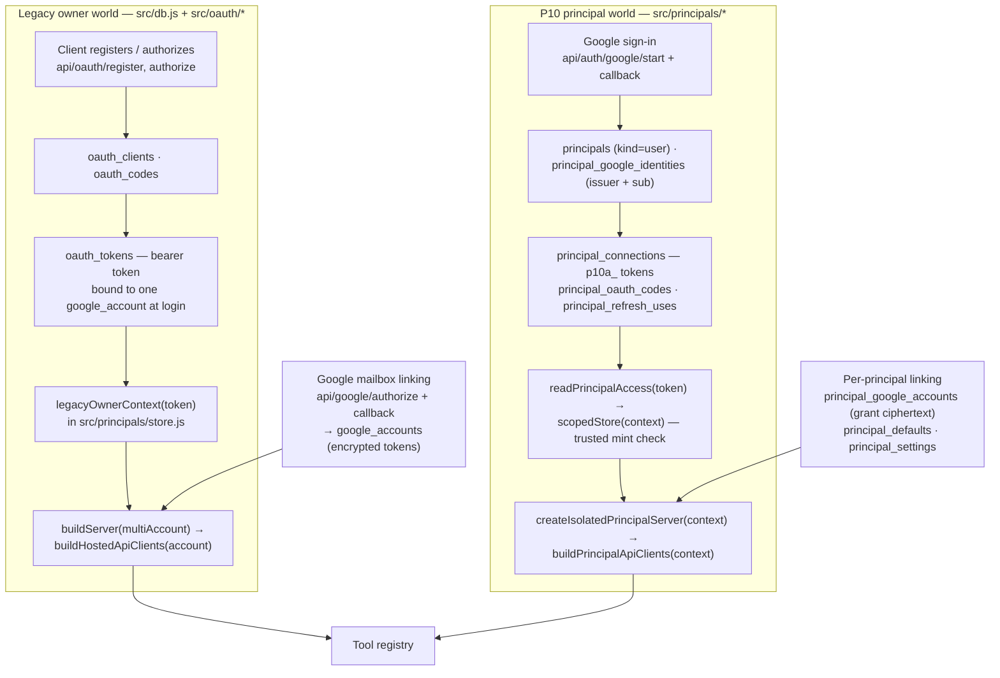

# Identity, OAuth and principals

There are **two identity worlds** in this server, deliberately kept apart.
Both end at the same tool registry, but they resolve credentials, linked
Google accounts and policy through different code and different tables.

## The server as OAuth authorization server

`src/oauth/` holds the machinery: `bearer.js` (token parsing),
`cimd.js` / `client-documents.js` (client identity metadata documents),
`client-compat.js` (CORS and client quirks), `login-guard.js` (login
attempt throttling, backed by `login_attempts`), `connection-settings.js`,
`google-setup-state.js`, and `connector-address.js` (named connector
paths under `/api/mcp/:connector`).

## Principals (`src/principals/`)

- `store.js` — schema and access for principals, identities, linked
  accounts, connections, sessions (`user_sessions`), settings, deletion
  requests, link/sign-in denial logs. `readPrincipalAccess`,
  `legacyOwnerContext`, `listAccounts`, `accountContext`, `scopedStore`.
- `clients.js` — `buildPrincipalApiClients(context)`: Google clients built
  only from that principal's own grants; there is no owner fallback.
- `google.js` / `canonical-entry.js` — Google identity verification and
  the canonical sign-in entry.
- `delegation.js` — user-chosen delegation: `principal_delegations` and
  `principal_delegation_subjects` record which subjects (e.g. other users
  in a domain) a principal's grant may act for, verified against Google.
- `owner-migration.js` — one-way bridge that links the legacy owner's
  existing `google_accounts` and `oauth_tokens` to the fixed owner
  principal, with login proofs (`principal_owner_login_proofs`).
- `security.js` — `publicMode(env)`: public execution is **off by
  default**; `api/mcp.js` additionally requires
  `PUBLIC_P10_TOOL_EXECUTION_VERIFIED=true` before any `p10a_` token may
  dispatch a tool.
- `session.js`, `pilot-readiness.js`, `public-information.js`,
  `tenant-store.js` — browser sessions, pilot gates, public pages, and
  tenant-scoped storage helpers.

## Per-person controls that shape dispatch

A principal's settings freeze into the server built for them: profile,
areas, listing mode, cost policy — and **writes paused** ("make all my
apps read-only") maps to `allow_writes: false`, which the RTC catalog
then enforces for every connection that person holds.
