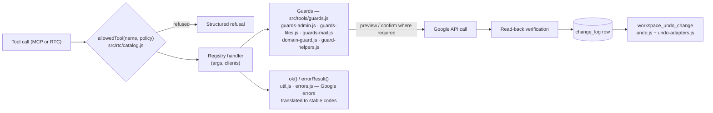

# Tool registry and the guard layer

`src/tools/index.js` assembles the registry from the tool modules in
`src/tools/`; duplicate names throw at import time. The generated catalog
in `README.md` (regenerate with `npm run gen:catalog`) is the count of
record: **388 registered tools**.

| Area | Tools | Main modules in `src/tools/` |
| --- | ---: | --- |
| admin | 112 admin tools | `admin-directory.js`, `admin-overview.js`, `admin-reports.js`, `admin-console-verify.js`, `licensing.js`, `extra-admin-apis.js`, `building.js`, `provision.js`, `staff.js`, `policy-audit.js`, `policy-scan.js`, `policy-evidence.js` |
| files | 103 files tools | `drive.js`, `docs.js`, `sheets.js`, `slides.js`, `forms.js` (via `src/auth/forms-client.js`), `shared-drives.js`, `business-resources.js` |
| mail | 60 mail tools | `gmail.js`, `inbox.js`, `dev-gmail.js`, `email-health.js`, `postmaster.js`, `mailbox-branding.js`, `digest.js` |
| workspace (meta) | 29 workspace tools | `accounts.js`, `ops.js`, `health-report.js`, `rtc-meta.js`, `account-choice.js`, plus the five protected meta dispatchers (`workspace_call`, `workspace_batch`, …) |
| calendar | 24 calendar tools | `calendar.js`, `calendar-deletion.js`, `dev-calendar.js`, `dev-calendar-snapshot.js` |
| tasks | 14 tasks tools | `tasks.js` |
| workflows | 12 workflows tools | `workflows.js`, `bulk.js` |
| people | 9 people tools | `people.js` |
| chat | 8 chat tools | `chat.js` |
| identity | 5 identity tools | `delegated.js`, account/connection tools |
| chrome / dns / domain / datatransfer | 3 chrome tools, 3 dns tools, 3 domain tools, 3 datatransfer tools | `chrome-target.js`, `dns.js`, `domains.js` (in `src/`), datatransfer tools |

Developer/integration tooling (`dev-*.js`, `dev-integration*.js`,
`dev-fixtures.js`, `dev-run-state.js`) registers test-mode tools backed
by the `dev_runs` / `dev_run_objects` / `dev_run_steps` tables — see
[05-data-store.md](05-data-store.md).

## The safety layer every write crosses

- Guards are applied when the registry is built (`applyGuards`), not by
  each handler remembering to call them; `scripts/check-writes.mjs` in
  `npm run check` fails the build if a changing tool lacks its guard.
- Destructive tools and billing-risk tools (license assignment, bulk
  operations) are flagged in RTC metadata (`toolMetadata` in
  `src/rtc/catalog.js`) so clients can warn before calling.
- Errors leave through one translation layer (`src/tools/errors.js`), so
  MCP and RTC callers see the same stable error codes — the RTC gateway
  maps them to HTTP statuses.
