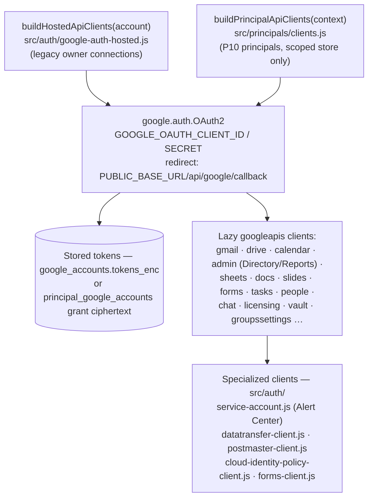

# Google clients, scopes and the service account

Tool handlers never build Google clients themselves. They receive a
`clients` object built per request for exactly one acting Google account.

## Two client factories, one shape

- Tokens auto-refresh through the OAuth2 client; refreshed credentials
  are persisted back to the same store they were read from.
- `handleGoogleCallback` never trusts the browser's claim about which
  mailbox signed in — it asks Gmail `users.getProfile` and files the
  tokens under the verified email.
- A request's `clients` also carries policy context: `rtcPolicy`,
  `connection` id, `allowedDomains` (from `google_accounts.allowed_domains`),
  and `forAccount()` for switching among the same person's linked accounts.

## Scopes (`src/auth/scopes.js`)

`ALL_SCOPES` is the union of named groups requested at standard sign-in:
gmail, drive, calendar, sheets, docs, slides, forms, tasks, contacts,
chat, adminDirectory, adminReports, adminSecurity, groupsSettings,
licensing, dataTransfer. Narrower purpose-specific sets exist for
read-only flows (`ACCEPTANCE_READ_SCOPES`, `CATALOG_READ_SCOPES`,
`TASKS_READ_SCOPES`, `POSTMASTER*_READ_SCOPES`,
`SITE_VERIFICATION_READ_SCOPES`, `COMPLETION_READ_SCOPES`,
`cloudIdentityPolicies`) and are requested with
`include_granted_scopes: true` so they add to, never replace, a grant.
Delegated scopes are listed separately in `src/auth/delegation-scopes.js`.

## The service account (robot identity)

`src/auth/service-account.js` builds a domain-wide-delegation service
account client, separately opted in by configuration. It exists for the
few operations user OAuth cannot do — principally **Alert Center**
(`apps.alerts`, read *and* write, therefore never part of ordinary user
login) and delegated access inside other users' Gmail settings, with
calendar and `drive.file` held in reserve. Its client ID and scope list
must exist in the customer's Admin console delegation entry; without
that configuration those tools report the API/delegation as unavailable
rather than falling back to user credentials.
