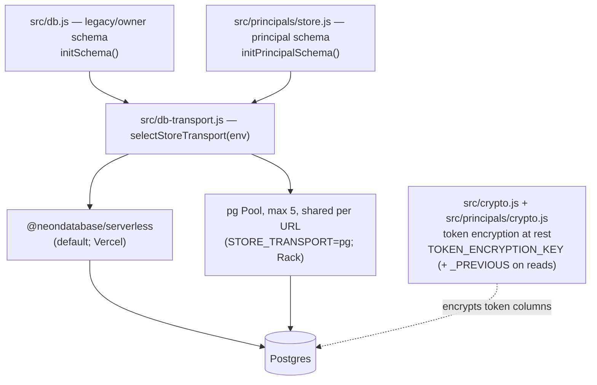

# Data store — Postgres

All durable state lives in one Postgres database. Code reaches it through
two schema owners and one transport switch.

## Table families

**Legacy / owner (src/db.js)**

- `google_auth` — pre-multi-account single sign-in (migration source).
- `google_accounts` — one row per linked mailbox: label, `is_default`,
  `allowed_domains`, token columns. Plaintext `tokens` is legacy;
  `tokens_enc` is the encrypted copy, and `google_token_storage` tracks
  the encrypted-only cutover state.
- `oauth_clients`, `oauth_codes`, `oauth_tokens`,
  `oauth_refresh_revocations` — this server's own OAuth issuance.
- `login_attempts` — login throttling.
- `rtc_results`, `rtc_passes`, `rtc_rate_limits` — RTC door state
  (see [06-rtc-and-hub.md](06-rtc-and-hub.md)).
- `change_log` — every guarded write, the source for undo.
- `business_resources`, `businesses` support (`src/businesses.js`).
- `dev_runs`, `dev_run_objects`, `dev_run_steps` — developer test runs.

**Principals (src/principals/store.js)**

- `principals` (the fixed legacy-owner row is seeded alongside `kind=user`
  rows), `principal_google_identities` (issuer + Google `sub` → principal),
  `principal_google_accounts` (per-principal grants, ciphertext),
  `principal_defaults`, `principal_legacy_accounts` (owner bridge).
- `principal_connections`, `principal_oauth_codes`,
  `principal_refresh_uses`, `principal_connect_handles` — P10 issuance.
- `user_sessions`, `user_oauth_transactions` — browser sign-in.
- `principal_delegations`, `principal_delegation_subjects` — delegation.
- `principal_settings` — per-person controls (profile, read-only switch…).
- `principal_deletion_requests`, `principal_link_denials`,
  `principal_signin_denials` — lifecycle and audit.
- `principal_owner_login_proofs` (`src/principals/owner-migration.js`).

## Rules of the store

- Schema is created additively at runtime (`IF NOT EXISTS`); there is no
  separate migration runner, and old/new code share the database during
  releases. Concurrent-DDL races are retried in `src/db.js`.
- Secrets at rest are encrypted (`tokens_enc`, grant ciphertext); tests
  use `test/helpers/fake-db.js`, and `test/contract/db-contract.js` runs
  the same contract against fake and real stores so they cannot drift.
- Database tests (`npm run test:db`) run against a disposable Postgres
  in their own temporary schema.
