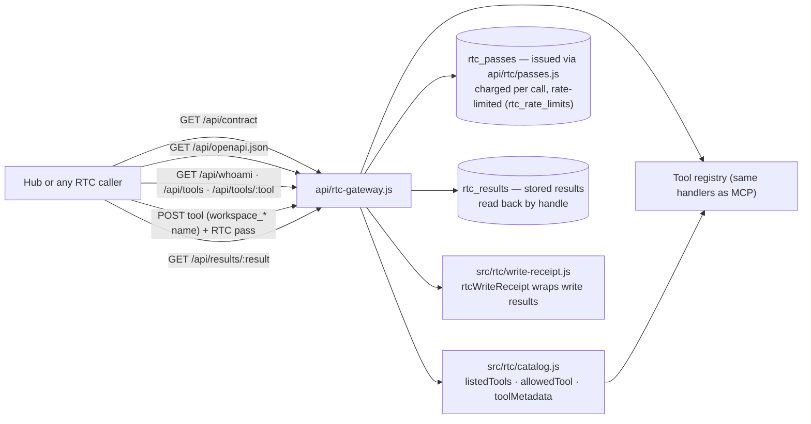

# RTC door and the Hub relationship

RTC ("Robinson Tool Contract", v1) is this server's second door: a plain
HTTPS surface that exposes the same registry to callers that do not speak
MCP — above all the optional Hub, which discovers this server, keeps
provider schemas out of an agent's default tool menu, and relays calls.

**Direction matters:** the Hub initiates everything. This server never
calls the Hub and installs no Hub-specific adapters
(`docs/HUB-COMPATIBILITY.md`).

## Pieces (`src/rtc/`)

- `catalog.js` — the policy lens over the registry: areas
  (`admin`, `mail`, `files`, `calendar`, `tasks`, `people`, `chat`,
  `workflows`, `workspace`, …), profiles (`read_only`, `everyday`,
  `full`), listing modes (`catalog`, `compact` — compact strips schema
  descriptions to fit a strict size budget), modes (`test`, `live`), and
  the protected meta-tools (`workspace_call`, `workspace_batch`, and the
  describe/search meta-tools) through which a caller reaches the full
  catalog from a small fixed menu.
- `openapi.js` — generates the OpenAPI document served at
  `/api/openapi.json` from the same metadata.
- `results.js` — stored-result shaping/redaction; a service pass
  (`rtc_pass_…`) must never appear in any RTC response, and the gateway
  scans the whole serialized envelope, not just direct results.
- `write-receipt.js`, `structured.js`, `summary.js`,
  `read-only-semantics.js`, `pass-options.js`, `billing-authority.js` —
  receipt schema, structured output handling, and pass/billing rules.
  RTC `money` is always false (no direct funds movement); billing *risk*
  is flagged separately on license/bulk tools.

## Conformance

`scripts/rtc-workspace-conformance.mjs`, `scripts/rtc-conformance-ci.mjs`
and `scripts/check-rtc-budget.mjs` (part of `npm run check`) keep the
gateway, the catalog budget and the canonical Hub contract in step.
