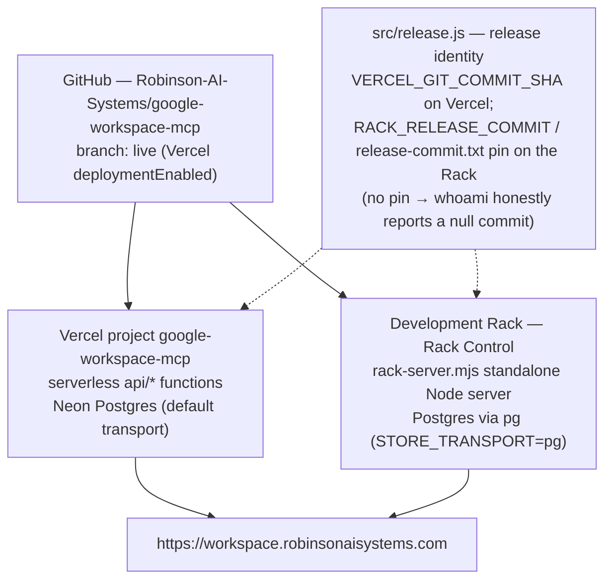

# Hosting and release

One codebase, two hosting shapes, identical `api/` handlers.

## Vercel shape

- `vercel.json` rewrites: `/` → front door, `/.well-known/*` → OAuth
  discovery, `/api/mcp/:connector` → the MCP function, the RTC doors
  (`/api/contract`, `/api/openapi.json`, `/api/whoami`, `/api/tools*`,
  `/api/results/:result`) → `api/rtc-gateway.js`, `/brand/:asset` and
  `/favicon.ico` → `api/brand.js`.
- Function ceilings: `api/mcp.js` 60 s; `api/oauth/*` and `api/google/*`
  30 s. Git deployments are enabled only for the `live` branch.
- `PUBLIC_BASE_URL` is the service identity every OAuth redirect and
  discovery document is built from.

## Rack shape

- `rack-server.mjs` is a thin standalone HTTP server with **no
  application logic**: it binds every `api/**/*.js` default export to its
  `/api/*` path, applies the `vercel.json` rewrites verbatim, parses
  bodies per each function's exported `bodyParser` config (Vercel's
  4.5 MB default otherwise), and imposes no duration ceiling of its own.
- It pins release identity before accepting traffic
  (`RACK_RELEASE_COMMIT` or `release-commit.txt` beside the server).

## External dependencies outside this repo

- **Google Cloud project** holding the OAuth client
  (`GOOGLE_OAUTH_CLIENT_ID/SECRET`) and the delegation service account.
- **Google Admin console** domain-wide delegation entry for the service
  account's client ID and scopes.
- **Postgres** — Neon (Vercel shape) or the Rack's Postgres (Rack shape);
  one database per deployment, schema created by the code itself.
- **Secrets by environment only** — OAuth secrets, token encryption keys
  (`TOKEN_ENCRYPTION_KEY`, optional `_PREVIOUS` during rotation), and
  feature gates (`PUBLIC_BASE_URL`, `STORE_TRANSPORT`, P10 pilot flags).

## Checks that guard a change

`npm run check` (syntax on every source file, guarded-writes check,
RTC budget, catalog freshness, developer-evidence and session checks)
plus `npm test`, and `npm run test:db` / `test:rtc` against disposable
Postgres — run by GitHub CI on every pull request (Node 24).
